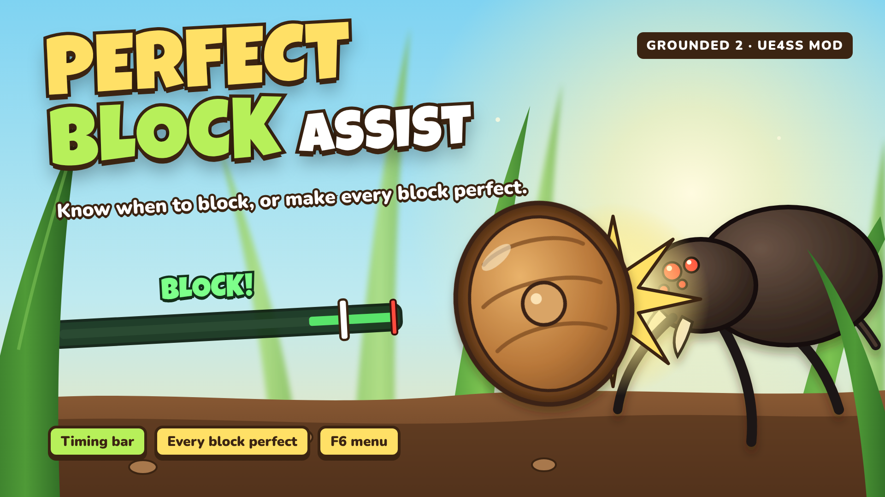

<p align="center">
  
</p>

# Perfect Block Assist: Grounded 2

Helps you land **Perfect Blocks** in Grounded 2. You can use a timing bar that shows exactly when to block,
or switch to a mode where every block counts as perfect. You choose the mode in an in-game menu (**F6**).

> 🇧🇷 [Leia em português](#português)

## Features

- **Timing bar:** when an enemy near you starts an attack, a bar appears under the crosshair. A marker
  runs towards the hit, and a green zone marks the game's own Perfect Block window. Start blocking when the
  marker is inside it and **BLOCK!** appears.
  - The countdown is read from the attack animation every frame, so it follows combos, faster attacks and
    interrupted attacks. In testing it was within about 10 ms of the real hit.
  - Works with every creature: spiders, ants, scorpions, mosquitoes, cockroaches, mites, larvae, bosses such
    as the Tarantula, and more.
  - You still block by hand. In this mode the mod only reads the game.
- **Every block is perfect:** any block that takes a hit counts as a Perfect Block. The game's original
  window comes back when you switch to another mode.
- **In-game menu (F6):** mode, how early the bar appears, bar size and bar position. Settings are saved.
- English and Brazilian Portuguese (follows the game's language).
- Pure UE4SS Lua mod: no game files are replaced and nothing runs outside the game.

## Requirements

- Grounded 2 (Steam)
- [UE4SS for Grounded 2](https://www.nexusmods.com/grounded2/mods/259)

## Installation

1. Install **UE4SS for Grounded 2** into
   `...\steamapps\common\Grounded2\Augusta\Binaries\Win64\`
2. Copy the `PerfectBlockAssist` folder into
   `...\Grounded2\Augusta\Binaries\Win64\ue4ss\Mods\`
   (it already contains `enabled.txt`, no need to edit `mods.txt`).

When you enter your world, the bar shows a short preview twice so you can see it works.

## Usage

Press **F6** in game to open the menu.

| Key | In the menu |
|---|---|
| `F6` | Open / close |
| `Up` / `Down` | Choose an option |
| `Left` / `Right` | Change it |

| Option | Values |
|---|---|
| Mode | Timing bar · Every block is perfect · Off |
| Bar lead time | 0.5 – 2.0 s before the hit (default 1.0) |
| Bar size | Small · Medium · Large |
| Bar position | Pixels below the screen centre (steps of 20) |

While the menu is open in bar mode, the bar keeps running as a preview so you can adjust it.

## Configuration

The menu writes `PerfectBlockAssist\config.ini`. You can also edit it by hand:

```ini
Mode = bar          ; bar, perfect or off
LeadTime = 1.0
BarSize = medium    ; small, medium or large
OffsetY = 120
MenuKey = F6        ; F1 - F12
Language = auto     ; auto, en or pt-br
```

Advanced options (distance, facing angle, logging) are at the top of `Scripts\main.lua`.

## How it works

- **Timing bar:** each enemy attack in Grounded 2 is an animation montage, and the moment it deals damage
  is a *HitFrame* notify inside it. The mod watches the creatures near you (25 m). When one plays a montage
  with a hit, the mod reads the montage position and play rate every frame and works out the time left.
- **Every block is perfect:** the game counts a block as perfect when the hit lands within a short window
  after you start blocking (0.4 s by default). The mod makes that window very long on your character.

## Limitations

- **Multiplayer:** "every block is perfect" works for the host only. The timing bar works for everyone
  but was mainly tested in single player.
- The mosquito's dive hits on contact, not at a fixed point of the animation, so it gets no bar.
- When several enemies attack at once, the bar shows the attack that lands first.
- The arrow keys also reach the game while the menu is open.

## Troubleshooting

`...\Win64\ue4ss\UE4SS.log`, lines starting with `[PerfectBlockAssist]`. For more detail set
`Verbose = true` at the top of `Scripts\main.lua`: every attack and block is then logged with the timing.
Open an issue with the log.

## Uninstall

Delete the `ue4ss\Mods\PerfectBlockAssist` folder. The Perfect Block window is not saved in your save game,
so nothing stays changed.

## Credits

- Inspired by [PerfectBlockTrainer](https://www.nexusmods.com/grounded2/mods/198) by diosama258. This is an
  independent mod; no files from it are included.
- [UE4SS](https://github.com/UE4SS-RE/RE-UE4SS) team.

Not affiliated with Obsidian Entertainment, Xbox Game Studios or Microsoft.

---

## Português

Ajuda você a acertar o **bloqueio perfeito** no Grounded 2. Escolha o modo no menu do jogo (**F6**):

- **Barra de tempo:** quando um inimigo perto de você começa um ataque, aparece uma barra abaixo da mira.
  O marcador corre até o golpe e a faixa verde é a janela de bloqueio perfeito do próprio jogo. Bloqueie
  quando o marcador estiver nela e aparece **BLOQUEIE!**. Você continua bloqueando na mão.
- **Todo bloqueio é perfeito:** qualquer bloqueio que receber um golpe conta como perfeito. A janela
  original volta quando você troca de modo.
- **Desligado.**

No menu, as setas **Cima/Baixo** escolhem e **Esquerda/Direita** alteram. Também dá para mudar a antecedência,
o tamanho e a posição da barra. As escolhas ficam salvas em `config.ini`.

**Requisitos:** Grounded 2 (Steam) e [UE4SS for Grounded 2](https://www.nexusmods.com/grounded2/mods/259).

**Instalação:** copie a pasta `PerfectBlockAssist` para `...\Win64\ue4ss\Mods\` (já vem com `enabled.txt`).

No multiplayer, o modo "todo bloqueio é perfeito" funciona só para quem hospeda o mundo.

## License

[MIT](LICENSE)
